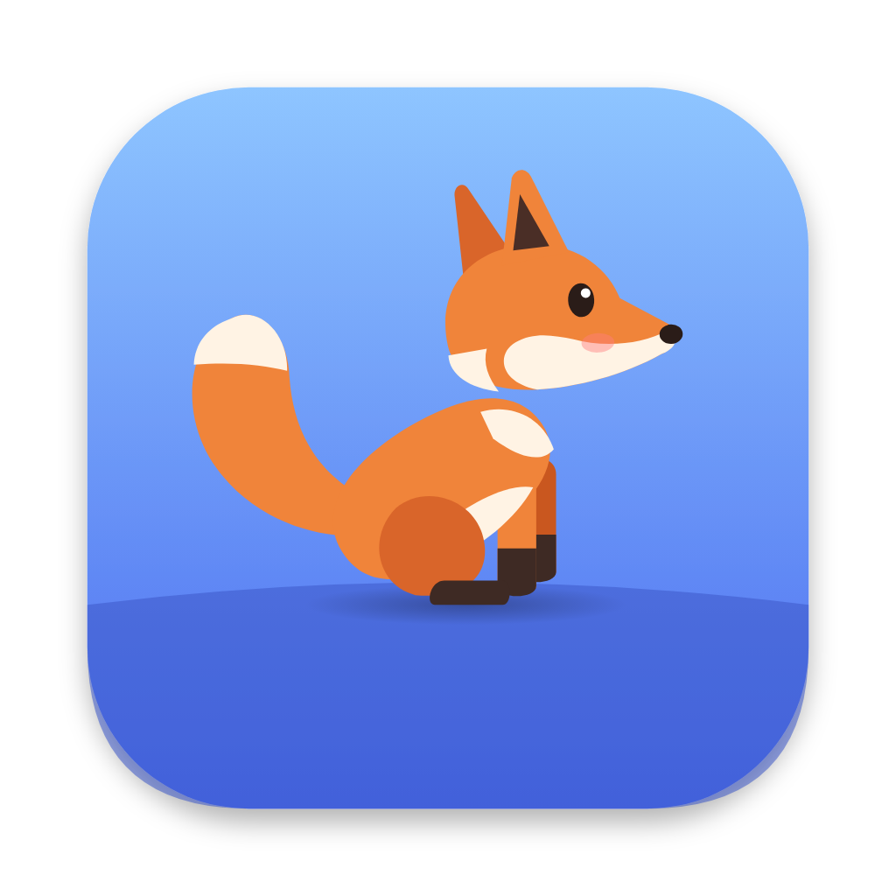

<p align="center">
  
</p>

<h1 align="center">Kit</h1>

<p align="center">
  A little fox that lives on your macOS desktop.<br>
  <b>C++20 · Qt 6 / QML · AppKit · CoreGraphics · Objective-C++</b>
</p>

<!-- demo: add resources/demo.gif and uncomment
<p align="center">
  
</p>
-->

---

Kit is a desktop pet: a fox cub that walks along the bottom of your screen, hops onto your windows, rides along when you move them, naps when you step away — and reacts to you. It's drawn entirely in code (vector shapes animated at your display's refresh rate), lives in the menu bar and never steals focus from the app you're working in.

## What it does

- **Walks on your windows.** The top edges of other apps' windows are platforms. Kit jumps up onto them, hops between them, and jumps down. Move a window and Kit rides along; close it and Kit falls.
- **Walks on the Dock.** The top of the Dock bar is a platform too; next to it Kit walks along the very bottom of the screen and slips behind the Dock.
- **Drag and throw.** Grab Kit by the scruff and it dangles like a pendulum; let go mid-swing and it flies with your throw, bouncing off screen edges. Throw it too hard and it lands dizzy.
- **Reacts to you.** Its eyes follow the cursor. Hold the cursor still near it and it crouches, wiggles and pounces. Flick the cursor past its nose and it startles. Stroke it with the cursor and it closes its eyes and hearts pop out.
- **Click it** for a happy hop, a backflip, a tail chase or a wag.
- **Sleeps when you're away.** After 45 s without keyboard or mouse input it curls up under its own tail; it wakes and stretches when you're back. Now and then it takes a nap on its own.
- **Stays out of the way.** Clicks pass through everywhere except the fox itself, it never activates or takes keyboard focus, and it hides in full-screen apps.

Menu bar: call Kit to the cursor, size (S / M / L), hide, launch at login.

## Architecture

```
src/
├── core/                   # plain C++20, no Qt, no OS → unit-tested
│   ├── World               # screens, windows → walkable platforms; ballistic jump solver
│   └── PetSim              # physics + behaviour state machine (20 activities)
├── app/
│   ├── Pet                 # feeds the sim (cursor, input idle time, windows), moves the window
│   └── Tray                # menu bar icon and menu
├── platform/
│   ├── Native_mac.mm       # CGWindowList, CGEventSource, AX (Dock bar), NSPanel, SkyLight full-screen check
│   └── Platform_stub.cpp
qml/                        # the fox rig: SVG paths, pose blending, particles
tests/                      # core tests: platforms, jumps, landing, riding, drag/throw, behaviour
```

Notable decisions:

- **Platforms from occlusion.** Each window's top edge is a platform, minus the parts covered by windows in front of it (`CGWindowList` is front-to-back). Only window frames are read, so no Screen Recording permission is needed.
- **One-way platforms.** Kit lands on an edge only when crossing it from above, so it can jump up *through* a window from below and land on top — the classic platformer rule.
- **Jumps are solved, not guessed.** For a target spot Kit computes the launch velocity of a parabola with a chosen apex height; tests check it lands exactly there.
- **The brain has no Qt in it.** `PetSim` takes an input struct (cursor, idle seconds, dt) and a world; that makes it deterministic with a seed and lets a ten-minute randomized run in the tests check that the fox never leaves the screen or produces NaNs.
- **Behind or above the Dock.** On the ground the window is a floating panel (below the Dock and the menu bar); while carried, flying or standing on the Dock it's raised above them. AppKit normally keeps windows below the menu bar; a tiny runtime subclass overrides `constrainFrameRect:toScreen:` so the fox can be dragged anywhere.
- **A tiny window that follows the fox**, not a full-screen overlay. The window is click-through (`ignoresMouseEvents`) except when the cursor is over the fox's hit box, and it's a non-activating panel, so clicking the fox never takes focus from your app. The sub-point part of the position is applied inside the window for smooth slow walking.
- **Drawn in code.** Every part is an SVG path in QML (`QtQuick.Shapes`, curve renderer). Poses are blends of three base poses (stand / sit / sleep) plus per-activity offsets and oscillations, so changing activity never pops. The artwork was prototyped in a browser first and the same paths were moved into QML.

## Building

```bash
brew install qt cmake ninja

# development
cmake -S . -B build -G Ninja -DCMAKE_PREFIX_PATH="$(brew --prefix qt)"
cmake --build build && ctest --test-dir build
./build/Kit.app/Contents/MacOS/Kit

# standalone app + .dmg + install to /Applications
./scripts/package.sh --install
```

Requires macOS 13+. The release build is for Apple Silicon (Homebrew Qt is arm64-only); on Intel, build from source.

**Accessibility permission (optional).** The Dock's own window covers the whole screen, so the size of the Dock bar is only available through the Accessibility API. Grant it in System Settings → Privacy & Security → Accessibility → Kit to let Kit walk on the Dock; without it everything else works and Kit walks behind the Dock. Ad-hoc signed development builds may lose the permission after a rebuild: remove Kit from the list and add it again.

## License

MIT
